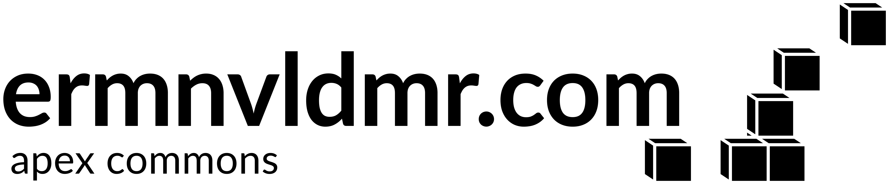

<p align="center">
  
</p>

# [apex.ermnvldmr.com](https://apex.ermnvldmr.com)

The boring, standard-library fleet operations framework powering self-hosted infrastructure across independent nodes.

## Quick Start

- **Live Documentation**: <https://docs.ermnvldmr.com/en/apex/> (also available in [Russian](https://docs.ermnvldmr.com/ru/apex/))
- **Getting Started Guide**: <https://docs.ermnvldmr.com/en/apex/getting-started/>
- **Report an Issue**: <https://github.com/deytenit/apex.ermnvldmr.com/issues>
- **License**: [BSD-2-Clause](#copyright--license)

```sh
# Clone your node's repository (which pins apex as commons/)
git clone --recurse-submodules git@github.com:you/selfhost.example.com.git
cd selfhost.example.com && ./init.sh && source ~/.bashrc

# Configure node identity
cat > node.env <<'EOF'
APEX_NODE_FQDN=selfhost.example.com
APEX_NODE_HOST=selfhost.example.com
APEX_SUBNET=198.18.16.0/24
EOF

# Configure host baseline and bring up compositions
apex configure        # firewall, crowdsec, cron, systemd, routing
apex compose up       # bring node services online
```

## Essential Information

You should understand the following invariants before exploring the codebase:

### Core Principles

- **No Control Plane**: No central orchestrator, agent daemon, or cluster controller. Commands act locally on the node you run them on.
- **Zero Build Step & Stdlib-Only**: Pure Python 3 standard library and Git. No `pip` dependencies, Node, Go, or code-generation steps.
- **Node-Owned Repositories**: Each machine is an independent Git repository pinning `apex` as a `commons/` submodule. It declares its own identity, compositions, and local overrides.
- **Overlay Architecture**: Node repositories can extend or override any shared action by placing an executable in `proprietaries/actions/`.

### Repository Structure

- **[`actions/`](./actions)**: Built-in engine actions (`compose.py`, `configure/`, `sync/`, `tiers/`, `backup/`, `utils/`).
- **[`compositions/`](./compositions)**: The shared core Compose stack (`traefik`, `socket-proxy`, `alloy`, `adguard`, `xray`, `restic`).
- **[`engine/`](./engine)**: Framework engine — action discovery, overlay resolution, context injection, and logging.
- **[`etc/`](./etc)**: Static service configurations, daemon templates, and helper scripts (Alloy configs, Happ generator).
- **[`ci/`](./ci)**: Host image build recipes (Packer for Debian 13) and cloud-init bootstrap templates.
- **[`assets/`](./assets)**: Repository branding assets (`logo.png`).

---

## Who Are You?

### Node Operator

Running and maintaining services on an existing host.

- **Requirements**: Debian-based host with Docker, Docker Compose v2, Git, and Python 3.
- **Workflow**:
  - Update services: `apex compose pull && apex compose up`
  - Run backups: `apex backup/run`
  - Sync repository state: `apex sync/repository`
- **Replication**: For multi-node high availability patterns and contracts, consult the [Composition Replication Documentation](https://docs.ermnvldmr.com/en/apex/concepts/replication/).

### Infrastructure Administrator

Bootstrapping clean Debian 13 hosts on bare metal or cloud providers without cloud-init support.

- **Initialization Tool**: A standalone workstation bootstrap tool targets clean Debian 13 amd64 installations using the same baseline as Packer.
- **Template**: Copy and fill out [`ci/cloud-init/user-data.template.yaml`](./ci/cloud-init/user-data.template.yaml) with target identity, operator keys, and node repository.
- **Run Enrollment**:
  ```sh
  python3 ci/scripts/init-node.py root@server --user-data /private/path/location.user-data.yaml
  ```
- **Security Handover**: Safely switches SSH to key-only authentication on port 2222 (`adam@server`) protected by an automated rollback watchdog, activates UFW firewall rules, Docker iptables integration, and CrowdSec.
- **Resuming**: Post-enrollment commands connect via `adam@server --port 2222`.

### Developer & Contributor

Adding shared actions or improving the engine.

- **Conventions**: Maintain strict Python standard library compliance. No external runtime packages.
- **Testing**: Run test suite via `python3 -m unittest discover -s tests`.
- **Linting**: Keep code formatted and clean according to PEP 8 standards.

---

## Communication & Support

- **Issues**: <https://github.com/deytenit/apex.ermnvldmr.com/issues>
- **Email**: <personal@ermnvldmr.com>

## Copyright & License

Licensed under the [BSD-2-Clause License](./LICENSE).

---

**AI Assistance**: Portions of this project's source code and configuration may have been developed with the assistance of AI code-generation tools.
