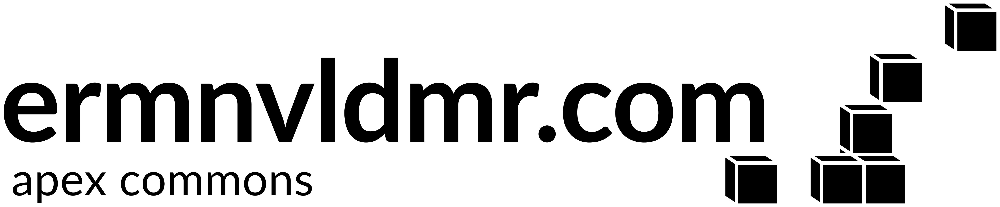

<p align="center">
  
</p>

# [apex.ermnvldmr.com](https://apex.ermnvldmr.com)

Local infrastructure operations for independently owned nodes, with a Python standard-library core.

## Quick Start

- **Live Documentation**: <https://docs.ermnvldmr.com/en/apex/> (also available in [Russian](https://docs.ermnvldmr.com/ru/apex/))
- **Getting Started Guide**: <https://docs.ermnvldmr.com/en/apex/getting-started/>
- **Report an Issue**: <https://git.ermnvldmr.com/deytenit/apex.ermnvldmr.com/issues>
- **License**: [BSD-2-Clause](#copyright--license)

```sh
# Clone your node's repository (which pins apex as commons/)
cd /srv
git clone --recurse-submodules ssh://git@git.example.com:22222/infrastructure/selfhost.example.com.git
cd selfhost.example.com && ./init.sh && source ~/.bashrc

# Configure node identity
cat > node.env <<'EOF'
APEX_NODE_FQDN=selfhost.example.com
APEX_NODE_HOST=selfhost.example.com
APEX_SUBNET=198.18.0.0/24
EOF

# Stock Debian Docker host, after configuring the node repository
apex config/packages
apex config/base
apex config/docker
apex config/ufw-docker
apex config/ufw       # apply the node firewall rules
apex composition/run up       # bring node services online
```

## Essential Information

You should understand the following invariants before exploring the codebase:

### Core Principles

- **No Control Plane**: No central orchestrator, agent daemon, or cluster controller. Commands act locally on the node you run them on.
- **Core Runtime**: Python 3.10 or newer and Git, with no `pip` dependencies or build step. Standalone host provisioning and workstation checks have separate requirements below.
- **Node-Owned Repositories**: Each machine is an independent Git repository pinning `apex` as a `commons/` submodule. It declares its own identity, compositions, and local overrides.
- **Overlay Architecture**: Node repositories can extend or override any shared action by placing an executable in `proprietaries/actions/`.

### Repository Structure

- **[`actions/`](./actions)**: Built-in engine actions (`composition/`, `config/`, `repository/`, `tier/`, `util/`).
- **[`compositions/`](./compositions)**: The shared core Compose stack (`traefik`, `socket-proxy`, `alloy`, `adguard`, `xray`, `restic`).
- **[`engine/`](./engine)**: Framework engine — action discovery, overlay resolution, context injection, and logging.
- **[`etc/`](./etc)**: Shared static configuration, including Alloy.
- **[`ci/`](./ci)**: Host image build recipes, cloud-init templates, and image enrollment tooling.
- **[`assets/`](./assets)**: Repository branding assets (`logo.png`).

---

## Who Are You?

### Node Operator

Running and maintaining services on an existing host.

- **Requirements**: Debian-based host with Docker, Docker Compose v2, Git, and Python 3.
- **Workflow**:
  - Update services: `apex composition/run pull && apex composition/run up`
  - Run backups: `apex tier/backup`
  - Sync repository state: `apex repository/sync`

Target a composition explicitly when operating on one application:

```sh
apex composition/run -p apex restart traefik
apex composition/run -p app up -d
apex composition/run --dry-run -p apex logs --tail 20 xray
```

The existing `apex compose` spelling is an alias for `apex composition/run`.
Wrapper options precede the action; remaining arguments go to Docker Compose.
The positional forms `apex composition/run restart apex traefik` and `apex composition/run up -d apex`
remain supported. Use `-p` when service names or option values could be mistaken
for composition names. Without a target, APEX visits core first, then other
compositions alphabetically; `down` reverses that order.

Replace `app` with a composition defined in your repository. Use targeted `up -d`
after changing a container definition; `restart` retains the existing definition.

For direct Docker Compose use in the core composition:

```sh
apex config/env --sync
cd compositions/apex
docker compose config --quiet
docker compose restart traefik
```

Sync preserves existing `.env` credentials and UID/GID entries, including tier
symlinks. It updates a managed block containing `apex.env` settings (including
profiles) followed by synthesized node/path values, and writes with mode `0600`.
Resync after changing `apex.env`, node identity, or tier paths. Shell environment
values still take precedence in Docker Compose. Do not edit the generated block.

`eval "$(apex config/env)"` exports synthesized APEX values to the current shell;
`apex config/env --dotenv` prints dotenv syntax, and `apex config/env --write generated.env`
writes those values to a separate file. These three modes do not merge the
composition's secrets or `apex.env`; use `--sync` for the complete core bridge.
Choose one output mode per invocation.

### Preparing an existing host

Run each setup action explicitly from the node checkout. Use `apex --help` to list the shared and node-owned actions. New actions follow `<singular-entity>/<action>`. Use `apex <entity>/<action> --help` for the arguments.

On an installed Proxmox VE host, `config/packages` installs the administrator tools and `config/base` applies APT and journald policy. The PVE host keeps its own storage, networking, firewall, and management listeners. Run workload configuration inside the guest that owns the service.

To set up the operator on either platform, start with an account that can administer the host:

```sh
apex config/adam --public-key-file /path/to/operator.pub
apex repository/chown
```

`config/adam` grants passwordless sudo. `repository/chown` gives adam ownership of the tracked checkout directly under `/srv` and its Git metadata.

Before moving SSH to port 2222, allow inbound TCP/2222 from the operator’s address through the provider firewall and the node’s firewall (UFW on stock Debian or the PVE firewall). Keep the original administrator session open throughout the transition.

1. Run `./commons/apex config/hardening begin` from the node checkout in the original SSH session.
2. On your workstation, run `ssh -o ControlPath=none -o BatchMode=yes -p 2222 adam@node.example.com` using the operator key. In the new session, run `./commons/apex config/hardening finalize` from the checkout.
3. Run the same SSH command again from your workstation. From the checkout in this second fresh session, run `./commons/apex config/hardening commit` to cancel automatic rollback.

On stock Debian the final policy allows only `adam` on port 2222 using a public key. PVE retains ports 22 and 2222, requires public keys globally, and keeps root key access with `PermitRootLogin prohibit-password` and no `AllowUsers` restriction.

If a login fails, run `./commons/apex config/hardening rollback` from the checkout in the original session or let the timer restore the original SSH configuration five minutes after `begin`. Use `./commons/apex config/hardening status` to inspect the transition. [Action reference](https://docs.ermnvldmr.com/en/apex/reference/actions/#confighardening)

### Infrastructure Administrator

Build Debian 13 amd64 golden images with Packer, then supply node identity,
operator keys, and the node repository through
[`ci/cloud-init/user-data.template.yaml`](./ci/cloud-init/user-data.template.yaml)
at first boot. Keep filled user-data and repository credentials outside Git.

```sh
packer init ci/packer/apex-debian-13.pkr.hcl
packer validate ci/packer/apex-debian-13.pkr.hcl
packer build ci/packer/apex-debian-13.pkr.hcl
```

Cloud-init runs the image's bundled enrollment helper. After enrollment, apply the individual `config/*` actions required by the node, then run `apex composition/run up`.

### Developer & Contributor

Adding shared actions or improving the engine.

- **Conventions**: Maintain strict Python standard library compliance. No external runtime packages.
- **Public documentation**: Describe supported interfaces using synthetic examples. Keep deployment inventories, internal plans, operational runbooks, and host-specific configuration in their owning private repositories.
- **Setup**:
  ```sh
  python3 -m venv .venv
  . .venv/bin/activate
  python3 -m pip install ruff==0.17.2 'PyYAML>=6.0,<7'
  ```
- **Verification**: `make check` runs lint and both the core and image provisioning suites. `make test` (or `bash tests/run.sh`) runs both suites; discovery limited to `tests/` omits provisioning. PyYAML is needed for the provisioning tests, not core execution. Environment integration tests use `docker compose` or standalone `docker-compose` with `config`; no daemon is needed.
- **Linting**: Ruff checks correctness and security rules. Existing import-order, line-length, compact-statement, and annotation-style debt is explicitly deferred in `pyproject.toml` to avoid unrelated formatting changes. Without Ruff, `make lint` recursively checks Python compilation and fails on syntax errors; that fallback is not equivalent to Ruff. `make fmt` formats files and is a separate, deliberate operation.
- **Packer**: Run `packer init ci/packer/apex-debian-13.pkr.hcl` and `packer validate ci/packer/apex-debian-13.pkr.hcl` for template validation. A VM build or first-boot enrollment is a separate operation; unit tests and template validation do not demonstrate a deployed host.

---

## Communication & Support

- **Issues**: <https://git.ermnvldmr.com/deytenit/apex.ermnvldmr.com/issues>
- **Email**: <personal@ermnvldmr.com>

## Copyright & License

Licensed under the [BSD-2-Clause License](./LICENSE).

---

**AI Assistance**: Portions of this project's source code and configuration may have been developed with the assistance of AI code-generation tools.
